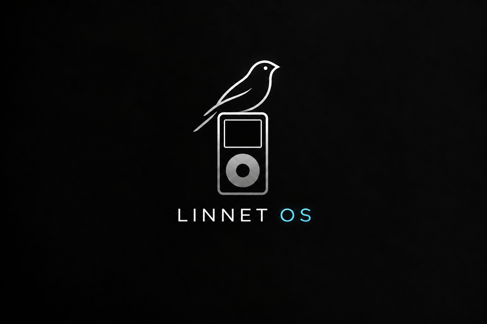
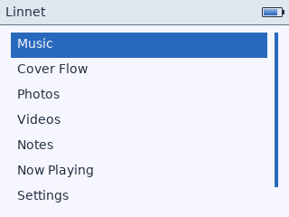
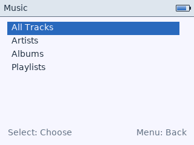
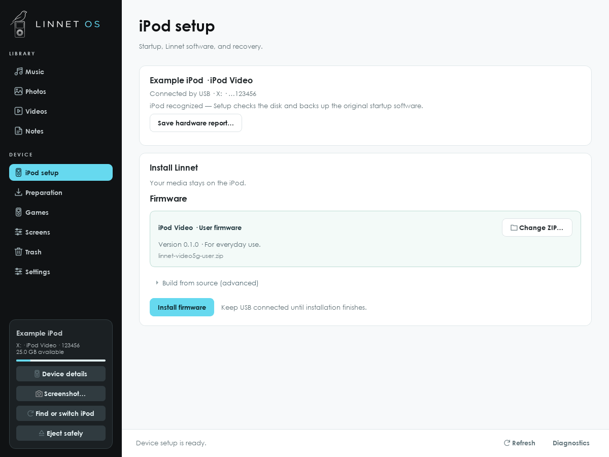
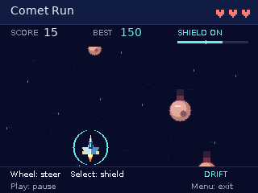
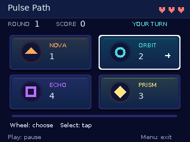
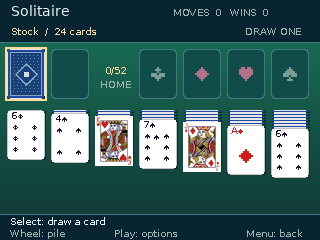
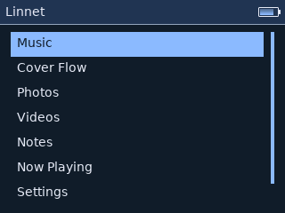
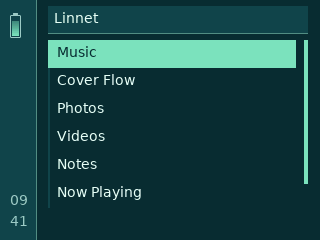
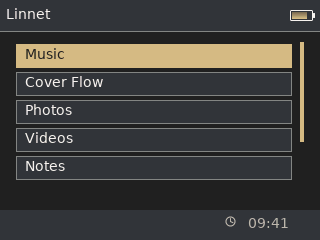

<a name="top"></a>

<p align="center">
  
</p>

<h1 align="center">Your iPod. A whole new life.</h1>

<p align="center">
  Original native firmware. A modern desktop companion. A direct line to the hardware.<br>
  Built for the music, the click wheel, and everything you still want to make with them.
</p>

<p align="center">
  <a href="#get-started"><strong>Get started</strong></a> ·
  <a href="#linnet-media">Media Manager</a> ·
  <a href="#linnet-link">Linnet Link</a> ·
  <a href="#games">Games</a> ·
  <a href="#themes">Themes</a> ·
  <a href="#simulator">Simulator</a> ·
  <a href="#confirmed-hardware">Hardware</a> ·
  <a href="#develop-on-windows">Develop</a> ·
  <a href="#explore-the-project">Docs</a>
</p>

---

Linnet brings a new operating system to classic iPods: music, Cover Flow, photos,
video, games, notes, and an interface you can make your own. The desktop prepares
your library. The iPod runs native code. And when you're building something new,
Linnet Link lets you see and control what is happening on the real device.

**Your computer does the heavy preparation.** Layouts, fonts, artwork, photo
tiles, and library indexes are compiled or prepared on the host. UI definitions
become native C before they reach the iPod. Less work at playback time leaves
the device free to browse, draw, and play within its limited memory and CPU budget.

**Your iPod stays part of the development loop.** Send input, read live state,
capture its screen, and load a fresh development build over USB. Two-way
communication through Linnet Link keeps testing close to the hardware, without
switching to Disk Mode for every iteration.

**An original firmware, from the bootloader up.** Linnet has its own bootloader,
kernel, services, and interface, built around a native architecture and fixed
memory budgets. Its UI runs without a JavaScript runtime. Third-party codecs
and adapted components have their own [credits and provenance](#credits).

<table>
  <tr>
    <td align="center"><br><strong>A familiar wheel. A fresh interface.</strong></td>
    <td align="center"><br><strong>Your library, ready to explore.</strong></td>
  </tr>
</table>

<sub>Home and Music: native simulator previews with no personal library data.</sub>

## Linnet Media

### One place for your iPod.

The Media Manager handles the desktop side: organize your library, prepare assets,
install firmware, choose games, and arrange the screens you want on your iPod.

- **Music:** browse songs, albums, artists, and genres; prepare the library and artwork for the device.
- **Photos and video:** convert media into the formats and sizes your target supports, with preparation progress and caching.
- **Games and screens:** choose which games are available and customize your menu.
- **Firmware:** select a prebuilt ZIP, review the detected hardware, and install with backups and a recovery path.
- **Everyday updates:** add files or folders, prepare the changes, then safely eject. Originals are preserved.

<p align="center">
  
</p>

<sub>Firmware setup in the source version of Media Manager; the optional development build control is visible.</sub>

The packaged Windows app includes its Python runtime and dependencies. Installing
prebuilt firmware needs **no compiler, no Python setup, and no WSL**. Media
conversion uses FFmpeg and FFprobe. Extract a Windows build with both executables,
then select their folder in Settings; the app checks that each can run. See the
[setup and troubleshooting steps](docs/media-manager.md#set-up-ffmpeg-on-windows).

[Explore Media Manager →](docs/media-manager.md)

## Linnet Link

### Build it. Send it. See it on the real iPod.

Linnet Link is the two-way USB connection between your computer and a running
development build. The device can report back while you inspect and control it:

| From your computer | Back from your iPod |
| --- | --- |
| Send wheel and button input | Observe the resulting UI and firmware state |
| Request a screen capture | Receive the actual framebuffer, checked for transfer integrity |
| Exercise playback and device services | Read diagnostics, logs, timing, and counters |
| Upload a freshly built image | Boot it temporarily in RAM, or install a persistent update |

This workflow **does not require Disk Mode**. Change code, try it on hardware,
and see the result without a manual file-copy cycle. Temporary RAM boots let you
try an image without replacing the installed OS.

Link is included in **development and trace builds**. Regular release builds
leave out the developer transport. Full library transfers still use Disk Mode;
firmware replacement stops playback and follows the update workflow.

[Use Linnet Link →](docs/device-link.md)

## Games

### The click wheel has more to do.

Eighteen native games bring different kinds of play to iPod Photo and Video, with
layouts made for their screens and controls made for the wheel.

<table>
  <tr>
    <td align="center"><br><strong>Comet Run</strong></td>
    <td align="center"><br><strong>Pulse Path</strong></td>
    <td align="center"><br><strong>Solitaire</strong></td>
  </tr>
  <tr>
    <td>Steer through meteors, time your shield, and chase your best score.</td>
    <td>Watch the pattern, turn the wheel, and play it back from memory.</td>
    <td>Draw-one Klondike, wheel navigation, legal-move hints, and undo.</td>
  </tr>
</table>

<sub>Actual iPod Video framebuffer captures through Linnet Link.</sub>

The full selection is Comet Run, Pulse Path, Solitaire, Sudoku, Brick, Music
Quiz, Vortex, Minesweeper, Falling Blocks, Reversi, Snake, Word Search, Scrub,
Dial Heist, Mixtape, Signal, Clockwork City, and Pocket Pinball.
Choose your games in Media Manager, save, eject, and restart Linnet.

## Themes

### Make it feel like yours.

Switch themes on the device, with palettes, fonts, and layouts compiled into the
firmware. Choose a quiet dark interface, warm Graphite, bright Aurora, or a
minimal look. **Album Colors** can follow the artwork of the current album across
the interface.

<table>
  <tr>
    <td align="center"><br><strong>Midnight</strong></td>
    <td align="center"><br><strong>Aurora</strong></td>
    <td align="center"><br><strong>Graphite</strong></td>
  </tr>
</table>

<sub>Native simulator previews at the iPod Video's 320 × 240 resolution. Theme availability depends on the target; the monochrome iPod uses its dedicated interface.</sub>

[Build an app or theme →](sdk/README.md)

## Simulator

### Start creating before you plug in.

Preview Linnet's interface on your computer using **the same native renderer and
compiled UI definitions** used by the firmware. Render screens, replay wheel and
button events from an input tape, and inspect the resulting frames in a browser.

The simulator produces PNG captures and a report for layout, theme, and input
work. Timing, sound, USB, and other hardware behavior still need a real iPod.
The theme previews above were generated with it.

[Run the simulator ↓](#preview-the-interface)

## Confirmed hardware

These targets have been exercised on physical devices. A matching family name
does not mean every capacity, board revision, or storage modification has been
qualified.

| iPod | Display | Target | Confirmed scope and limits |
| --- | --- | --- | --- |
| **iPod Photo · A1099** | 220 × 176 color | `photo4g-p98` | Primary development hardware. Music, photos, prepared IPVF video, games, and Link. [Target details](targets/photo4g-p98/README.md). |
| **iPod Video · A1136, 30 GB** | 320 × 240 color | `video5g-m25` | The MA146 / 32 MiB board: native startup, Link, stereo audio, photos, games, native H.264/MPEG-4 video, and Disk Mode exercised. [Qualification and remaining checks](targets/video5g-m25/QUALIFICATION.md). |
| **iPod classic · A1238 / N25** | 320 × 240 color | `classic6g-n25` | Native Boot, OS, Link, Disk Mode, and H.264 VGA playback verified. MPEG-4 qualification continues; automatic installation is disabled. |
| **iPod 4G monochrome · MP102 / Q21** | 160 × 128 monochrome | `ipod4g-q21` | Native startup and return to the preserved Apple OS verified. Two monochrome themes are enabled in the manifest; photos, video, Cover Flow, and games are disabled. |

Linnet is in active development. Feature coverage and hardware qualification vary
by target; see the [roadmap](docs/roadmap.md) and linked target notes.
To bring another model into the project, start with the [porting guide](targets/README.md).

## Get started

### Install a packaged build

> [!NOTE]
> Release packaging is ready, but downloadable releases have not been published yet.
> For now, use [the source setup below](#develop-on-windows). Published packages will appear on the [Releases page](https://github.com/jspann21/linnet/releases).

When release packages are available:

1. Download the **Windows Media Manager ZIP** and the **firmware ZIP for your target** from [Releases](https://github.com/jspann21/linnet/releases).
2. Extract the entire Media Manager ZIP and open **Linnet Media.exe**.
3. Connect the iPod in **Disk Mode** and select **Find iPod**.
4. Open **iPod setup → Choose firmware ZIP**, select your firmware, and review the installation options for the detected device. Classic uses a separate [bootstrap workflow](docs/bootstrap-tooling.md).
5. Install, safely eject, and restart into Linnet.

The native installer preserves the existing media and Apple firmware and saves
recovery backups. It requests Windows administrator approval for the required
device writes. With native Linnet and Apple fallback installed, hold **MENU**
during power-on to choose the preserved Apple software.

### Add your library

In Media Manager, select **Music**, **Photos**, **Videos**, or **Notes** and add your
files or folders. For media conversion, first select your FFmpeg/FFprobe folder
in **Settings**. Open **Preparation → Prepare selected media**, then **Eject safely** and restart.

On the iPod, a short **Play/Pause** press toggles playback or a photo slideshow.
Hold **Play/Pause alone for two seconds** to shut down; the Hold switch locks input.

[Installation, media preparation, and recovery →](docs/media-manager.md)

## Develop on Windows

### Clone. Set up. Build in PowerShell.

Install Git and **Python 3.11 or newer**, then run:

```powershell
git clone https://github.com/jspann21/linnet.git
cd linnet
python -m venv .venv
.\.venv\Scripts\python.exe -m pip install -r tools/studio/requirements.txt
.\.venv\Scripts\python.exe linnet setup
.\.venv\Scripts\python.exe linnet doctor
```

Setup downloads and verifies the pinned **LLVM 23.1.2** Windows compiler and builds
the native Apple database helpers. Development runs directly on Windows, including
the simulator and Media Manager. **WSL is not required.**

Build a regular release OS, using the target ID from the hardware table:

```powershell
.\.venv\Scripts\python.exe linnet build --target photo4g-p98 --profile release --verify
```

Build artifacts go into a unique `out/<profile>/<target>/<kind>/runs/` directory;
the command reports the resulting paths. Building an image does not install it.

### Open Media Manager from source

```powershell
.\.venv\Scripts\python.exe linnet media
```

To install or repeatedly test fresh firmware, enable **Build from source
(development)** under **iPod setup**. Choose **User build** for regular firmware
or **Developer build** for Linnet Link and device diagnostics. Media Manager uses
the same native Windows compiler and binds development builds to the detected iPod.
Its default installation path uses a selected prebuilt ZIP.

### Preview the interface

```powershell
.\.venv\Scripts\python.exe linnet simulator --target photo4g-p98 --all-scenes --output out/simulator
Start-Process out/simulator/index.html
```

Use your target's `system.toml` to select apps and a default theme. The SDK uses
constrained TSX compiled ahead of time to native C, with native callbacks for
behavior. See the [SDK](sdk/README.md) for templates and simulator input tapes.

### Build for Linnet Link

Development and trace images require the **actual device serial**:

```powershell
.\.venv\Scripts\python.exe linnet build --target photo4g-p98 --profile dev --device-serial YOUR_SERIAL --verify
```

Replace `YOUR_SERIAL` with the observed serial and select the matching target.
Start with Media Manager's **Developer build** installation, then follow the
[Link workflow](docs/device-link.md) for discovery, input, screenshots, RAM boot,
and persistent updates.

<details>
<summary><strong>Linux and existing compiler installations</strong></summary>

Install Python 3.11+ and LLVM 23.1.2 (`clang`, `ld.lld`, `llvm-objcopy`, and
`llvm-nm`) on PATH. Create a virtual environment with `python3 -m venv .venv`,
install `tools/studio/requirements.txt`, and use `.venv/bin/python linnet` for
the commands above. Windows `setup` installs the portable compiler automatically;
Linux developers supply their host toolchain.

Set `LINNET_LLVM_BIN` to an existing compiler's `bin` directory to override tool
discovery. `doctor` checks the pinned version. The Windows simulator also needs
the host headers and libraries supplied with LLVM-MinGW.

</details>

<details>
<summary><strong>Package firmware and the Windows app</strong></summary>

```powershell
.\.venv\Scripts\python.exe linnet release bundle --target photo4g-p98 --output out/releases/linnet-photo4g-p98.zip
.\.venv\Scripts\python.exe -m pip install pyinstaller==6.22.3
.\.venv\Scripts\python.exe linnet release media --output out/releases/linnet-media-windows.zip
```

Repeat `release bundle` for each supported target. Firmware ZIPs include verified
release OS and Boot images, including both startup-selector variants. Build the
Media Manager package on Windows; its ZIP includes the runtime and dependencies.

</details>

## Explore the project

| I want to… | Start here |
| --- | --- |
| Manage media or install and restore firmware | [Media Manager](docs/media-manager.md) · [Storage compatibility](docs/storage.md) |
| Build an app, theme, or screen | [SDK and templates](sdk/README.md) · [UI compiler](docs/ui-compiler.md) |
| Talk to a running iPod | [Linnet Link](docs/device-link.md) |
| Understand the firmware | [Architecture and source map](docs/architecture.md) · [Binary formats](docs/formats.md) |
| Work on media formats | [Music](docs/music-format.md) · [Photos](docs/photo-format.md) · [Video](docs/video-format.md) |
| Add another iPod | [Hardware porting guide](targets/README.md) |
| Contribute or find open work | [Contributing](CONTRIBUTING.md) · [Roadmap](docs/roadmap.md) |
| Understand generated files and recovery artifacts | [Local artifacts](docs/local-artifacts.md) |

## Credits

Linnet's native architecture and application code are developed for this project.
The firmware also incorporates third-party codecs, libraries, and adapted
algorithms, including components sourced through Rockbox. Their licenses and
origins are recorded in [third-party provenance](third_party/README.md), the
[SDK's font and theme notes](sdk/README.md), and the
[game artwork credits](targets/photo4g-p98/README.md).

<p align="center"><a href="#top">Back to top ↑</a></p>
